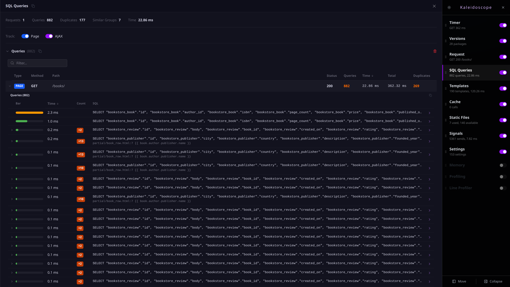

<p align="center">
    <picture>
        <source media="(prefers-color-scheme: dark)" srcset="assets/kaleidoscope-wordmark-on-dark.svg">
        <source media="(prefers-color-scheme: light)" srcset="assets/kaleidoscope-wordmark-on-light.svg">
        
    </picture>
</p>

&nbsp;

<p align="center">
    A debug toolbar for Django.
</p>

<p align="center">
    <a href="https://github.com/braycarlson/kaleidoscope/actions/workflows/publish.yml"></a>
    <a href="https://pypi.org/project/django-kaleidoscope/"></a>
    <a href="https://www.python.org"></a>
    <a href="LICENSE"></a>
</p>



## Overview

The kaleidoscope toolbar records what a request did and renders it as a set of panels over the page. There are twelve panels by default, covering SQL, templates, cache calls, signals, static files, settings, versions, timing, memory, the request itself, and two profilers. This is useful for finding N+1 queries, slow views, and template rendering costs during development.

The toolbar installs as a single middleware and mounts into a shadow root, so the page it inspects cannot restyle it and its own stylesheet cannot reach the page.

## Prerequisites

- Django 4.2+
- Python 3.11+
- `DEBUG` must be `True`, unless `KALEIDOSCOPE_SHOW_CALLBACK` is set

## Installation

```
pip install django-kaleidoscope
```

Add the app, the middleware, and your address to your Django settings:

```python
INSTALLED_APPS = [
    'kaleidoscope'
]

MIDDLEWARE = [
    'kaleidoscope.middleware.KaleidoscopeMiddleware'
]

INTERNAL_IPS = ['127.0.0.1']
```

The middleware belongs after `GZipMiddleware`. A compressed response carries a `Content-Encoding` and the injector refuses it, so a toolbar loaded first never appears. A system check reports the ordering at startup.

## Configuration

| Setting | Description | Default |
|---------|-------------|---------|
| `INTERNAL_IPS` | The addresses that see the toolbar while `DEBUG` is on. | `[]` |
| `KALEIDOSCOPE_IGNORE_PATHS` | The path prefixes the middleware skips. | `[]` |
| `KALEIDOSCOPE_PANELS` | The dotted paths of the panels to load, at most 64. The load order is the strip's default order. | The twelve defaults |
| `KALEIDOSCOPE_SHOW_CALLBACK` | A dotted path to a callable taking the request, replacing the `DEBUG` and `INTERNAL_IPS` check. It may be sync or async, and is adapted to whichever the request needs. | `None` |

There are eight system checks at startup, reporting a missing middleware, a middleware registered twice, a middleware ordered before `GZipMiddleware`, an empty `INTERNAL_IPS` with no callback, a panel path that will not import, a panel that is not a `Panel` subclass, a `KALEIDOSCOPE_PANELS` that is not a list, and a `KALEIDOSCOPE_IGNORE_PATHS` that is not a list of path prefixes.

## Panels

| Panel | Description | Isolated |
|-------|-------------|----------|
| Timer | The wall time for the request, with its method, path, status, and whether it ran under ASGI. | |
| Versions | The versions of the installed packages. | |
| Request | The method, path, headers, cookies, GET and POST data, the resolver match, the session, the user, and each permission check. | |
| SQL Queries | Each statement with its time, parameters, stack, and template lines, grouped into duplicates and N+1 candidates, with its query plan on request. | |
| Templates | Each template rendered, including `` parents and `` templates, with its duration and context. | |
| Cache | Each `add`, `clear`, `delete`, `delete_many`, `get`, `get_many`, `get_or_set`, `has_key`, `incr`, `set`, and `set_many` call with its key, result, and time. | |
| Static Files | The files referenced by the response, against each file the finders can see. | |
| Signals | Each signal the request sent with its sender, receivers, time, and call site, and the receivers connected to each signal. | |
| Settings | The resolved settings for the project. | |
| Memory | The heap difference across the request by type, split into allocated, freed, and unchanged. | Yes |
| Profiling | A pyinstrument call stack, rendered inline and openable in its own tab. | Yes |
| Line Profiler | The per-line hits, time, and share of total for the resolved view. | Yes |

The panels are toggled at runtime from the strip, which persists the panel order, side, active panel, and collapsed state in `localStorage`.

## Example Project

The `example/` directory holds a Django project written to be slow. The columns carry no `db_index`, the model properties open a query each time they are read, and the aggregates are folded in Python instead of the database. Each page names the mistakes it is making.

| Page | Queries | Total |
|------|---------|-------|
| `/books/` | 882 | 277 ms |
| `/search/` | 1603 | 444 ms |
| `/authors/` | 673 | 194 ms |
| `/reports/` | 602 | 169 ms |
| `/customers/` | 503 | 143 ms |
| `/orders/` | 327 | 287 ms |
| `/` | 96 | 38 ms |
| `/books/optimized/` | 4 | 33 ms |

The `/books/optimized/` page renders the same sixty rows as `/books/` using `select_related`, `prefetch_related`, and `Count` and `Avg` annotations, which is the difference between 882 queries and 4.

```
just install
just reset
just run-server
```

The `just screenshot` recipe captures each panel into `example/screenshot/` and accepts a filter, such as `just screenshot queries`.
